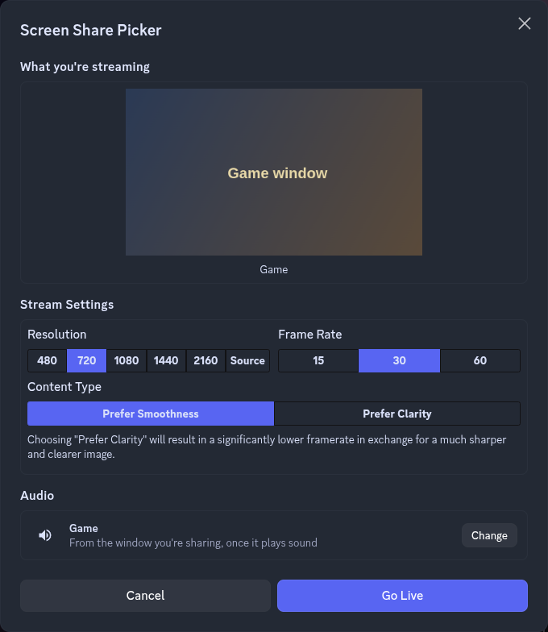
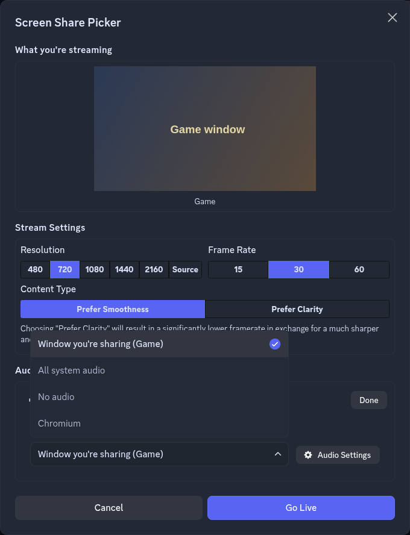

# Voxland Desktop

Voxland is a Discord client mod and Linux desktop app, forked from [Vencord](https://github.com/Vendicated/Vencord) and [Vesktop](https://github.com/Vencord/Vesktop). It welcomes contributions written with AI.

This repo is the desktop app: an Electron shell around Discord, built for Linux and Wayland. The client mod lives in [Rhinomcd/voxland](https://github.com/Rhinomcd/voxland).

## Why this exists

Discord on Linux still has rough edges, especially around streaming and screen sharing. Looking for alternatives led me to Vencord, its desktop app Vesktop, and Equicord, a fork of Vencord.

All of them are hostile to AI-assisted contributions, but none of them says clearly what is and isn't allowed. The rules [differ](https://github.com/Vendicated/Vencord/blob/e75ac9ace41f6212cfaa2d5f3670830be392da4e/CONTRIBUTING.md#ai-policy) between related repos, and some sit in places a contributor [never sees](https://github.com/Vencord/Vesktop/blob/a7a0e5d5c3a021a54aeda506e2cd3ea20d5c3efb/.github/pull_request_template.md?plain=1#L1-L4). [Similar PRs](https://github.com/Vencord/Vesktop/pull/1277#issuecomment-4826510080) get [very different treatment](https://github.com/Vencord/Vesktop/pull/1292#issuecomment-5040332173). Contributors don't get a policy. They get [mocked](https://github.com/Vencord/Vesktop/pull/1265#issuecomment-4480164228) in public review threads and [blocked without warning](https://github.com/Vendicated/Vencord/blob/e75ac9ace41f6212cfaa2d5f3670830be392da4e/.github/pull_request_template.md?plain=1#L14). [Profane](https://github.com/Vencord/Vesktop/commit/3cb2a7bc1306923b60157231430c5b4e78e531da), [hostile](https://github.com/Vencord/Vesktop/blob/a7a0e5d5c3a021a54aeda506e2cd3ea20d5c3efb/.github/pull_request_template.md?plain=1#L3) commit messages and comments are routine.

Voxland takes the opposite approach. The contribution policy is written down, including exactly how AI may be used, and the repo gives agents what they need to produce good PRs. With that in place, a community working alongside agents can ship more than a handful of maintainers can on their own.

Voxland is not affiliated with Discord, Vencord, Vesktop, or Equicord.

## Ground rules for contributors

These apply to every PR, whether a person, an agent, or both wrote it.

1. **Use AI openly.** Name the models and tools you used, for example in the PR's closing attribution line. We review the change, not who or what wrote it.
2. **A human answers for every PR.** If you opened it, you own it. You must be able to explain what it changes and why, and respond to review yourself.
3. **One problem per PR.** Split independent fixes into separate PRs, even small ones.
4. **Agree on features first.** Bug fixes can go straight to a PR. New features and changes to existing behavior start as a Discussion and need a maintainer's agreement before you build them.
5. **Show that it works.** Show how you (or better yet, your agents) reproduced the problem and checked the change, and what you saw. UI changes need before-and-after screenshots. "Tests pass" on its own is not evidence.
6. **Follow AGENTS.md.** It holds the project's conventions. Point your agent at it before it starts.
7. **Every PR gets AI review.** CodeRabbit and Macroscope review each PR. Fix or answer their findings before you ask for human review.

## What maintainers commit to

1. **A written policy that keeps evolving.** These rules are a starting point, not a rulebook set in stone. Tools and models change quickly, so we revise the policy often and in the open. When a PR shows a gap, we update the docs and explain why.
2. **We make good PRs easy to write.** The repo carries what agents need: AGENTS.md, scripts that launch and check the app, CI, and AI review. When agents keep making the same mistake, we fix the repo with a lint rule, a test, or a doc instead of blaming the contributor.
3. **A reason for every closed PR.** A closed PR gets a short explanation that names the rule it broke or the problem with the change.
4. **Blocks are a last resort.** We block accounts for harassment or repeated, deliberate spam, never for a single PR that misses the bar.
5. **Professional conduct.** We critique code, not people, in reviews, comments, and commit messages alike. Everyone else is held to the same standard.

## Screen share audio on Hyprland

When you share a window, Voxland sends that app's audio, like Discord on Windows does. When you share a whole screen, it sends all system audio except Discord's own. "Change" in the picker overrides either choice.

| Sharing a window sends its app's audio                                                                  | "Change" picks another source                                                                     |
| ------------------------------------------------------------------------------------------------------- | ------------------------------------------------------------------------------------------------- |
|  |  |

The portal never tells the app which window you picked. To let Voxland see the choice, pipe your xdg-desktop-portal-hyprland picker through [`scripts/linux/voxland-record-share-pick`](scripts/linux/voxland-record-share-pick). Save this as an executable `~/.local/bin/my-share-picker`:

```sh
#!/bin/sh
hyprland-share-picker "$@" | /path/to/voxland-record-share-pick
```

Then point xdg-desktop-portal-hyprland at it in `~/.config/hypr/xdph.conf`:

```ini
screencopy {
    custom_picker_binary = /home/you/.local/bin/my-share-picker
}
```

Voxland uses `pw-dump` (in `pipewire` on Arch, `pipewire-utils` on Fedora, `pipewire-bin` on Debian) to match apps that put no process id on their audio streams, such as Java games like RuneLite, and to keep a live share following the app after Go Live. Without it, audio is matched once at Go Live and only updated when the shared window closes, and system audio with apps left out stays silent.

Without the hook, Voxland cannot tell what you shared, so the stream starts without audio and the picker asks you to choose it.

## Installing

There are no packaged releases yet. Build from source.

## Building from source

You need [Git](https://git-scm.com/downloads) and [Vite+](https://viteplus.dev/guide/) (`vp`), which also manages Node.js and the package manager.

```sh
git clone https://github.com/Rhinomcd/voxland-desktop
cd voxland-desktop
vp install

vp run start                     # build and run without packaging
vp run package                   # build packages for your OS into dist/
vp run package --linux pacman    # only the Linux pacman package
vp run package:dir               # unpacked app directory only
```

## Running the Voxland mod

On first launch the app downloads the upstream Vencord build. To run the Voxland mod instead, build [Rhinomcd/voxland](https://github.com/Rhinomcd/voxland) and point Settings → Developer Options → Open Developer Settings → Vencord Location at its `dist` folder.

## Building libvesktop

libvesktop is a small C++ helper the app uses on Linux to emit D-Bus events. Prebuilt binaries for x64 and arm64 ship with the repo. To build your own:

1. Install the build dependencies:
    - Debian/Ubuntu: `apt install build-essential python3 curl pkg-config libglib2.0-dev`
    - Fedora: `dnf install @c-development @development-tools python3 curl pkgconf-pkg-config glib2-devel`
2. Run `vp run buildLibVesktop`. Later builds of the app use your copy.
